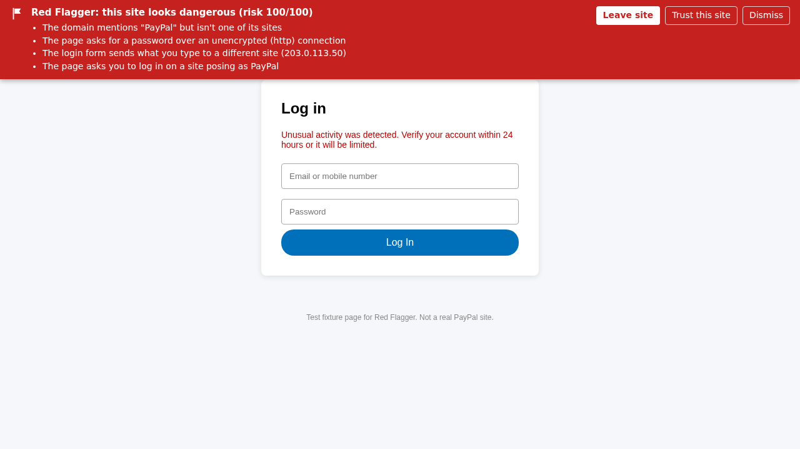
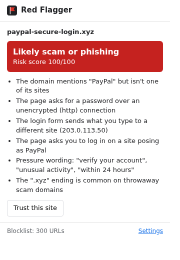
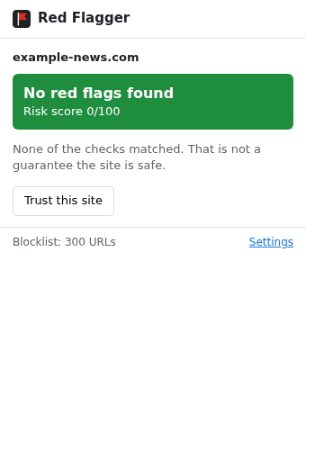
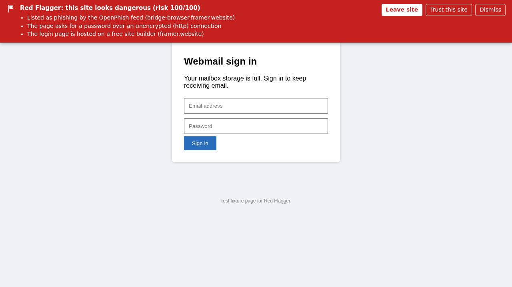
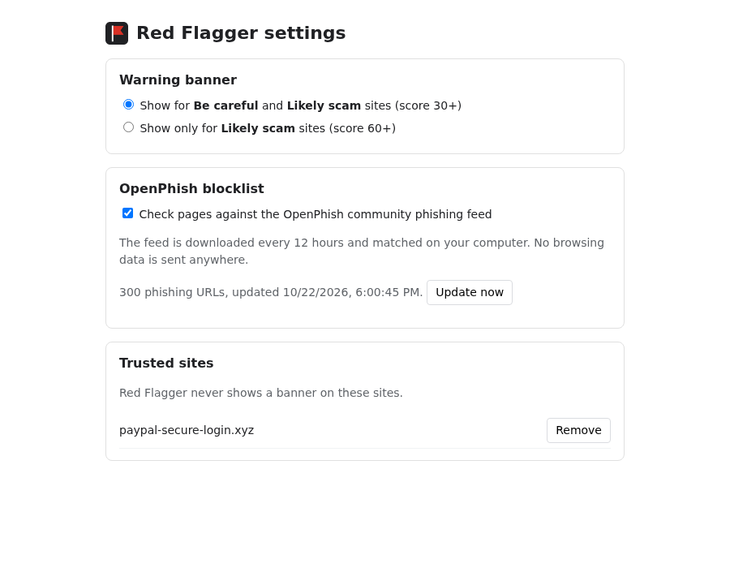
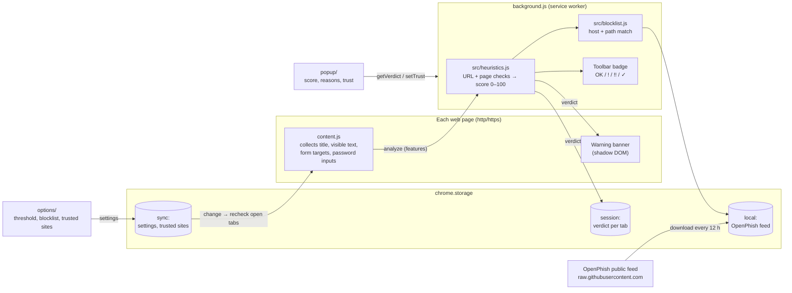

# Red Flagger

A Chrome extension (Manifest V3) that warns you when a page looks like a scam or phishing site. It checks each page **on your own machine**, using URL and page heuristics plus the free [OpenPhish](https://openphish.com/) community blocklist. No page content or browsing history is sent anywhere.



| Popup on a flagged page | Popup on an ordinary page |
| --- | --- |
|  |  |

A page whose host is on the OpenPhish feed (here a feed entry mapped to a local test page):



The screenshots come from local test pages loaded under fake domains (for example `paypal-secure-login.xyz`) in Chrome 137. They are not real phishing sites.

## What it does

- **Toolbar badge** on every http/https page: `OK` (green), `!` (amber, be careful), `!!` (red, likely scam), `✓` (a site you trust).
- **Warning banner** at the top of risky pages, listing the reasons. It has *Leave site*, *Trust this site* and *Dismiss* buttons.
- **Popup** with the site's risk score (0–100), every reason found, and a trust/untrust button.
- **Settings page**: choose when the banner appears (score 30+ or 60+ only), turn the blocklist on or off and update it, and manage trusted sites.



## How detection works

Each page gets a score from 0 to 100. Below 30 is shown as safe, 30–59 as "be careful", 60+ as "likely scam or phishing".

| Check | Example |
| --- | --- |
| On the OpenPhish blocklist | exact hostname plus path prefix match against the downloaded feed |
| Brand name on a domain that isn't the brand's | `paypal-secure-login.xyz`, `amaz0n-billing.com` (also one-letter misspellings and digit swaps) |
| Login form on a look-alike domain | password field on a site posing as PayPal |
| Password field over plain http | `http://…` page with `<input type="password">` |
| Login form sends data to another site | form `action` pointing to a different registrable domain or an IP |
| Login page on a free site builder | `*.webflow.io`, `*.framer.website`, `*.pages.dev`, … |
| Raw IP address, `@` in the URL, punycode (`xn--`) domain | `http://203.0.113.50/login` |
| Risky domain endings, very long or hyphen-heavy domains, deep subdomains | `.zip`, `.xyz`, `.top`, … |
| Pressure wording | "verify your account", "unusual activity", "within 24 hours" |
| Asks for a wallet seed phrase or private key | "enter your 12-word recovery phrase" |

The blocklist is downloaded from `raw.githubusercontent.com/openphish/public_feed` when the extension starts and every 12 hours, stored in `chrome.storage.local`, and matched locally. The content script only collects the page title, up to 20,000 characters of visible text, form targets and whether password or secret inputs exist; it passes them to the extension's own service worker, which scores them.

## Architecture

Everything runs inside the browser. The only network request the extension makes is the blocklist download.



1. `content.js` runs on each page at `document_idle` (and once more after 3 s if a password field appears late). It sends the page features to the service worker.
2. The service worker scores the URL and features with `src/heuristics.js` and looks the URL up in the stored OpenPhish feed with `src/blocklist.js`.
3. The verdict is saved per tab in `chrome.storage.session`. It sets the badge, and the banner is shown if the level reaches the threshold you chose and the site isn't trusted.
4. Trusting a site or changing the threshold (from the banner, popup or settings) updates `chrome.storage.sync`, and every open tab is re-checked straight away.

## Install (unpacked)

1. Download this repository (green **Code** button → **Download ZIP**) and unzip it, or `git clone` it.
2. Open `chrome://extensions` in Chrome (or Edge: `edge://extensions`).
3. Turn on **Developer mode** (top right).
4. Click **Load unpacked** and pick the folder that contains `manifest.json`.
5. Pin Red Flagger from the puzzle-piece menu so you can see its badge.

Pages that were already open before you installed it need a reload.

## Limitations

- These are heuristics. They will miss some scams (for example a polished fake shop on an ordinary `.com` domain with no login form), and they can flag legitimate sites, such as a small business whose login page is hosted on a free site builder. Use *Trust this site* for false positives.
- The free OpenPhish feed holds only a few hundred recent URLs, so most phishing sites will not be on it. Detection relies mainly on the heuristics.
- The brand list covers about 30 common targets (PayPal, Apple, Microsoft, Google, Amazon, banks, couriers, crypto wallets, Indian payment apps…). Brands not on the list are not checked for impersonation.
- Domain parsing uses a short built-in list of multi-part suffixes (`co.uk`, `co.in`, …), not the full Public Suffix List.
- It is not a replacement for Chrome's built-in Safe Browsing protection; keep that turned on.

## Development

Requires Node.js 20+.

```bash
npm install
npm run lint
npm test
```

Detection logic lives in `src/heuristics.js` and `src/blocklist.js`. Both are plain scripts that run in the service worker and in Node, so they are unit-tested in `tests/` without a browser. CI runs lint and tests on every push and pull request.

```
manifest.json        extension manifest (MV3)
background.js        service worker: scoring, blocklist download, badge, per-tab verdicts
content.js           collects page features, shows the warning banner
src/heuristics.js    URL and page heuristics
src/blocklist.js     OpenPhish feed parsing and matching
popup/               toolbar popup
options/             settings page
icons/               extension icons
tests/               node:test unit tests
```

## License

[MIT](LICENSE)
